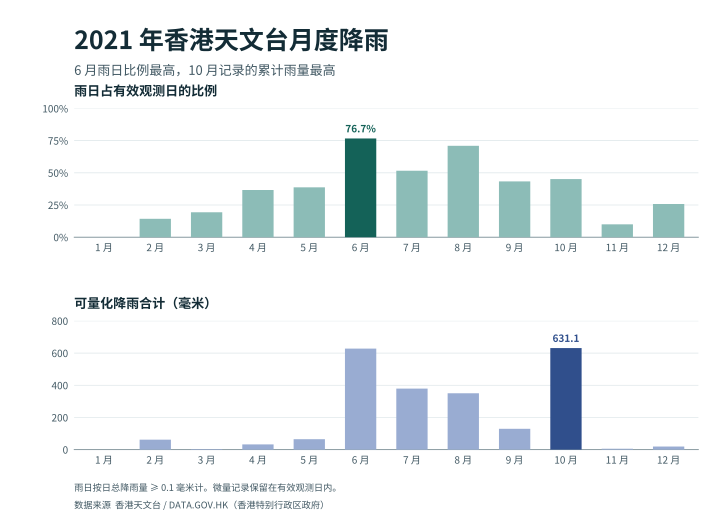

# 香港天文台 2021 年雨日复算

**6 月的雨日最多，有 23 天，占当月有效观测日的 76.7%。10 月只计 14 个雨日，但可量化雨量合计 631.1 毫米，为当年各月最高。** 这份练习回答「下雨有多频繁」和「一共下了多少」两个问题。

## A 数据逻辑

分析范围为香港天文台站（HKO）2021 年 1 月 1 日至 12 月 31 日。原始表每行表示该站某一天的总降雨量，结果按月份排列。主归属是**编年型**，因为月份顺序组织了变化。案例背景见 [CASE-012 香港历年降雨主图](../../02-信息图形类型案例/10-单一图表型-Single-Chart/案例/CASE-012-香港历年降雨主图/分析.md)，本练习使用公开逐日数据另作单年分析。

数据来源为香港特别行政区政府香港天文台及 DATA.GOV.HK。原始数据的知识产权归香港特别行政区政府及相关机构所有。[政府开放数据目录](https://data.gov.hk/en-data/dataset/hk-hko-rss-daily-total-rainfall) · [天文台官方 2021 年 CSV](https://data.weather.gov.hk/weatherAPI/cis/csvfile/HKO/2021/daily_HKO_RF_2021.csv) · [政府开放数据使用条款](https://data.gov.hk/en/terms-and-conditions)

## B 统计方法与计算

| 原始值或状态 | 计入有效观测日 | 计入雨日 | 汇总雨量时的处理 |
|---|---|---|---|
| 完整记录，日总雨量 ≥ 0.1 毫米 | 是 | 是 | 加入原始数值 |
| 完整记录，日总雨量为 0.0 毫米 | 是 | 否 | 加入 0.0 |
| 完整记录，`Trace`（微量，低于 0.05 毫米） | 是 | 否 | 保留标记，合计只加有确切数值的记录 |
| 缺日期、`***`（无数据）或完整性字段不是 `C` | 否 | 否 | 留为缺测 |

雨日阈值采用天文台公布的「日降雨量至少 0.1 毫米」口径。若有完整的正数记录低于阈值，也只计入有效观测日和可量化雨量。[天文台雨日统计口径](https://www.hko.gov.hk/en/cis/statistic/rf_1.htm)

1. 按公历列出当年每个日期，核对是否重复与是否缺测。逐条读取原文件的降雨量与完整性字段。
2. 每月把符合阈值的观测数出来，得到雨日数。**雨日比例＝雨日数 ÷ 有效观测日数 × 100%**。若整月无有效记录，比例留空。微量日有观测值类型，仍计入分母。
3. 分别计算雨日比例与可量化雨量合计。全年比例用全年雨日数除以全年有效观测日数。比例在最后一步保留一位小数。

用 6 月手算时，30 天都有完整观测，其中 23 天至少 0.1 毫米，另有 4 天为微量。雨日比例是 **23 ÷ 30 × 100% ≈ 76.7%**。

## C 视觉编码

上下两张柱状图使用相同的月份顺序和从零开始的纵轴。上图柱高表示雨日比例，可以比较天数不同的月份。下图柱高表示可量化雨量合计，单位是毫米。每张图用深色标出自己的最高月份。



## D 数据架构与复算

原表字段为年、月、日、数值（毫米）、数据完整性。汇总表一行是一个月，最后一行是全年。保存的 CSV 与官方 2021 年文件一致。[逐日原始 CSV](./daily_HKO_RF_2021.csv) · [Python 复算脚本](./recalculate.py)

下载 CSV 和脚本放在同一文件夹。在该文件夹运行下列命令，即可输出和下表对应的结果。脚本使用 Python 3 标准库。

```bash
python3 recalculate.py
```

| 月份 | 日历天数 | 有效观测日 | 缺测日 | 雨日数 | 微量日 | 雨日比例 | 可量化雨量合计（毫米） |
|---|---:|---:|---:|---:|---:|---:|---:|
| 1 月 | 31 | 31 | 0 | 0 | 1 | 0.0% | 0.0 |
| 2 月 | 28 | 28 | 0 | 4 | 3 | 14.3% | 62.1 |
| 3 月 | 31 | 31 | 0 | 6 | 8 | 19.4% | 3.5 |
| 4 月 | 30 | 30 | 0 | 11 | 4 | 36.7% | 32.5 |
| 5 月 | 31 | 31 | 0 | 12 | 7 | 38.7% | 65.0 |
| 6 月 | 30 | 30 | 0 | 23 | 4 | 76.7% | 628.0 |
| 7 月 | 31 | 31 | 0 | 16 | 6 | 51.6% | 379.5 |
| 8 月 | 31 | 31 | 0 | 22 | 4 | 71.0% | 350.5 |
| 9 月 | 30 | 30 | 0 | 13 | 3 | 43.3% | 129.6 |
| 10 月 | 31 | 31 | 0 | 14 | 6 | 45.2% | 631.1 |
| 11 月 | 30 | 30 | 0 | 3 | 6 | 10.0% | 5.8 |
| 12 月 | 31 | 31 | 0 | 8 | 5 | 25.8% | 19.5 |
| **全年** | 365 | 365 | 0 | 132 | 57 | 36.2% | 2307.1 |

365 条日记录已逐条对照香港天文台年报表 6。各月可量化数值与表 6 的月合计相符。1 月仅有一条微量记录，表 6 的当月总量保留为 `Trace`，上表的 0.0 表示数值列的可量化合计。全年可量化合计 2,307.1 毫米，与天文台公布的全年雨量一致。[2021 年气象观测摘要表 6](https://www.hko.gov.hk/tc/publica/smo/files/SMO2021.pdf) · [2021 年天气回顾](https://www.hko.gov.hk/en/wxinfo/pastwx/2021/ywx2021.htm)

## E 视觉叙事与结论

先读上图，找出哪一月下雨最频繁，再读下图，看累计雨量最高的月份。6 月有 23 个雨日，10 月有 14 个。回到逐日表就能看到，10 月 8 日单日记录了 **329.7 毫米**，占 10 月可量化合计的约 **52.2%**（329.7 ÷ 631.1）。一天的雨量可能很大，在雨日统计里仍只计一天。

这份结果描述的是**单一站点在 2021 年的观测**。要判断历年趋势，需要在同一站点、同一口径下扩展年份，并逐年核对缺测情况。

[返回统计图形分析](../README.md) · [编年型信息图形概念](../../01-信息图形数据逻辑/01-编年型信息图形概念定义.md)
