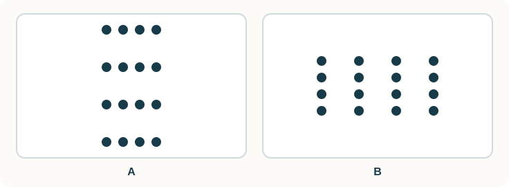

# G01 接近律（Proximity）

研究层次为 **知觉分组**。

## 定义

相对距离会影响分组。其他条件相近时，靠得更近的元素更容易被看作一组。

## 图解

左右两幅都有 16 个大小和颜色相同的圆点。左图横向中心距 24、纵向中心距 54，容易看成四行。右图交换两种间距，容易看成四列。

## 信息图形中的应用

把指标名、数值和单位放在同一视觉组内，给相邻指标留出更大的组间距。比较组内和组间距离时，同时检查容器与颜色是否给出相同提示。

距离支持的是版面上的归属判断。距离压缩到印刷比例或小屏时，应重新检查文字、图注和邻组之间的间隔。

## 相关案例与对照

[《PlayStation 演变图》](../02-案例与设计分析/01-PlayStation演变图.md) · [间距与颜色 A/B](../03-跨原则对照/01-分组线索-间距与颜色.md) · [边框与间距 A/B](../03-跨原则对照/02-分组线索-边框与间距.md)

## 来源

- [Wagemans 等（2012），视觉知觉中的分组与图底组织](https://doi.org/10.1037/a0029333)
- [Nielsen Norman Group，视觉设计中的接近原则](https://www.nngroup.com/articles/gestalt-proximity/)

[返回目录](../README.md) · [概念与分类框架](../00-Gestalt概念与分类框架.md)
