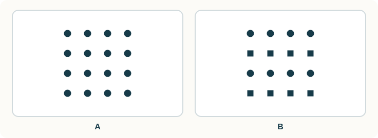

# G02 相似律（Similarity）

研究层次为 **知觉分组**。

## 定义

具有相同或相近视觉属性的元素容易被读成一组。可起作用的属性包括颜色、形状、方向、尺寸和纹理。

## 图解

两幅点阵的中心位置相同。左图形状一致，右图把隔行的圆改成方形，空间上分离的方形行仍容易被认成同类。

## 信息图形中的应用

同一数据类别沿用同一符号。颜色承担分类时，也可以用形状或直接标签让读者有第二条识别线索。

一种视觉属性应有稳定的含义。例如颜色表示类别时，数值大小用长度或位置表达。

## 相关案例与对照

[《PlayStation 演变图》](../02-案例与设计分析/01-PlayStation演变图.md) · [香港天文台月度降雨图](../02-案例与设计分析/03-香港天文台月度降雨图.md) · [间距与颜色 A/B](../03-跨原则对照/01-分组线索-间距与颜色.md)

## 来源

- [Wagemans 等（2012），视觉知觉中的分组与图底组织](https://doi.org/10.1037/a0029333)

[返回目录](../README.md) · [概念与分类框架](../00-Gestalt概念与分类框架.md)
