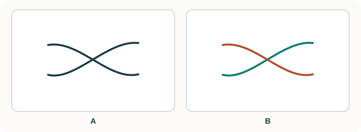

# G03 良好连续律（Good Continuation）

研究层次为 **知觉分组**。

## 定义

方向衔接平滑的线段或轮廓，容易被知觉为同一条路径，即使中间有交叉或短暂遮挡。

## 图解

左图两条同色曲线交叉。右图用两种颜色标明沿平滑方向延伸的两条路径，便于核对读法。

## 信息图形中的应用

画交叉路线时，用一致的走向帮助追踪。需要表达换乘或汇合时，在交点加显式节点。

平滑线形会加强连续感。折线图遇到缺测时要明确标出缺口或交代处理方式。

## 相关案例与对照

[《PlayStation 演变图》](../02-案例与设计分析/01-PlayStation演变图.md) · [《财富》都会区营收图](../02-案例与设计分析/02-财富500强都会区营收图.md)

## 来源

- [Wagemans 等（2012），视觉知觉中的分组与图底组织](https://doi.org/10.1037/a0029333)

[返回目录](../README.md) · [概念与分类框架](../00-Gestalt概念与分类框架.md)
