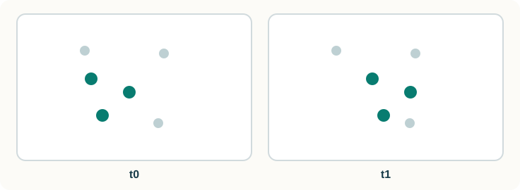

# G04 共同命运律（Common Fate）

研究层次为 **知觉分组**。

## 定义

多个元素朝相同方向运动时，容易被感知为同一群。方向一致是经典示例，速度相近也可加强这种感觉。

## 图解

两格是连续时刻。三颗深色圆在两帧中都向右移 42 个坐标单位，浅色圆留在原位。读图时比较深色圆在两帧中的坐标变化。

## 信息图形中的应用

在动态流向图中，可让代表同一类流向的标记沿相同方向运动，把运动方向写进图例。

静态箭头提供方向线索，连续帧或实际动画才能展示位移过程。例图中的浅深色辅助追踪同一元素。

## 来源

- [Wagemans 等（2012），视觉知觉中的分组与图底组织](https://doi.org/10.1037/a0029333)
- [Wagemans，《Perceptual Organization》章节，共同命运与同步分组](https://www.nssrperception.com/docs/Wagemans%202018%20Perceptual%20organization.pdf)

[返回目录](../README.md) · [概念与分类框架](../00-Gestalt概念与分类框架.md)
