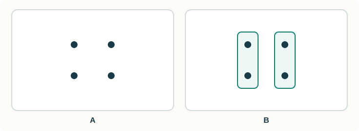

# G05 共同区域律（Common Region）

研究层次为 **知觉分组**。

## 定义

落在同一个可辨边界内的元素容易被看成一组。边界可以由描边或一块清楚的底色形成。

## 图解

两幅图的点位置相同。右图加入两个框，分别框住每列的两个圆，因此出现左右两组。

## 信息图形中的应用

给同一指标的标题、数值和单位加共同的底色，或用浅色小面板分开不同口径的图表。

容器边界会传达归属。跨两组的说明需要放在公共区域，避免看起来只属于其中一组。

## 相关案例与对照

[边框与间距 A/B](../03-跨原则对照/02-分组线索-边框与间距.md)

## 来源

- [Wagemans 等（2012），视觉知觉中的分组与图底组织](https://doi.org/10.1037/a0029333)
- [Palmer（1992），共同区域与知觉分组](https://doi.org/10.1016/0010-0285(92)90014-S)

[返回目录](../README.md) · [概念与分类框架](../00-Gestalt概念与分类框架.md)
