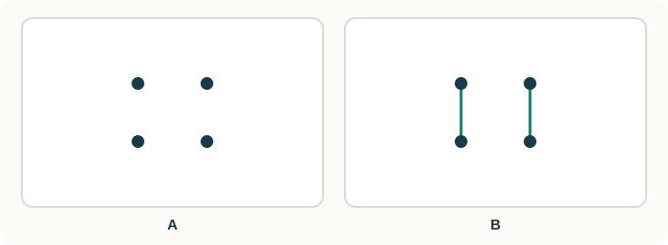

# G06 连接律（Connectedness）

研究层次为 **知觉分组**。

## 定义

用线把元素直接连接，容易使读者理解为一对或一条关系。视觉属性均质且连续的区域也容易被当成一个单位，研究中称为一致连接。

## 图解

两幅图的圆位置相同。右图两条短线各自连接一对圆。示意图展示的是元素之间的直接连接。

## 信息图形中的应用

网络图明确每种线表示哪种关系。地理图中，一个连续的同色区域也可组织为一块整体。

检查每条线的两端和含义。线段交叉处是否构成节点，需要单独用节点符号或图例说明。

## 相关案例与对照

[《财富》都会区营收图](../02-案例与设计分析/02-财富500强都会区营收图.md)

## 来源

- [Wagemans 等（2012），视觉知觉中的分组与图底组织](https://doi.org/10.1037/a0029333)
- [Palmer 与 Rock（1994），一致连接与知觉组织](https://doi.org/10.3758/BF03200760)

[返回目录](../README.md) · [概念与分类框架](../00-Gestalt概念与分类框架.md)
