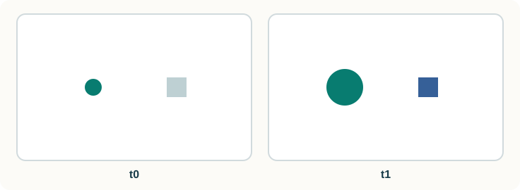

# G07 同步律（Synchrony）

研究层次为 **知觉分组**。

## 定义

多个元素在同一时刻发生可见变化时，容易被读成属于同一事件。变化可以发生在不同视觉属性上。

## 图解

两格是连续时刻。左圆在第二帧放大，右方块在第二帧变深，两者位置固定。一格包含一组同一时刻的状态。

## 信息图形中的应用

交互图表触发筛选时，同步更新地图标记和列表提示，帮助读者把它们理解为同一次操作的反馈。

实际界面可用选中边框和状态文字延续关联。示意图把大小和明暗变化放在同一帧，实际同步效果仍取决于播放时序。

## 来源

- [Wagemans 等（2012），视觉知觉中的分组与图底组织](https://doi.org/10.1037/a0029333)
- [Wagemans，《Perceptual Organization》章节，共同命运与同步分组](https://www.nssrperception.com/docs/Wagemans%202018%20Perceptual%20organization.pdf)

[返回目录](../README.md) · [概念与分类框架](../00-Gestalt概念与分类框架.md)
