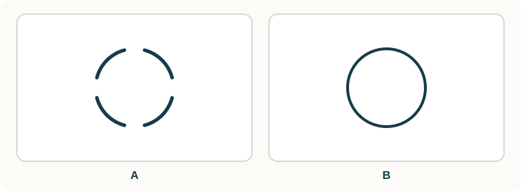

# G08 闭合律（Closure）

研究层次为 **形状与轮廓**。

## 定义

轮廓有缺口时，方向和位置足够支持某个形状，人仍可能把局部组织成一个完整形态。

## 图解

左图的四段短弧位于同一个圆周上。右图画出完整圆作参照，便于检查缺口在脑中被怎样补足。

## 信息图形中的应用

可在标题图标中留出小缺口，观察保留的转角或弧线是否足够表达原形。

地理边界和数据范围需要可辨。具有明确语义的轮廓，优先保证读者能准确辨认。

## 来源

- [Wagemans 等（2012），视觉知觉中的分组与图底组织](https://doi.org/10.1037/a0029333)

[返回目录](../README.md) · [概念与分类框架](../00-Gestalt概念与分类框架.md)
