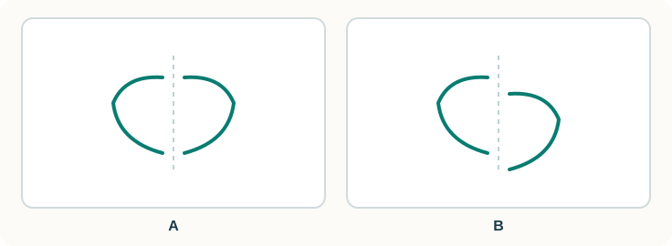

# G09 对称律（Symmetry）

研究层次为 **形状与轮廓**。

## 定义

围绕一条轴彼此镜像的轮廓，容易被组织成一对或一个整体。

## 图解

两幅图的虚线都是参考轴。左图两半互为镜像，右图把右半下移，镜像配对变弱。

## 信息图形中的应用

双侧比较图可以围绕共用基线布置同一指标的两组值，帮助读者沿水平位置配对。

对比数据采用共同的尺度和明确口径。左右对称的构图可以容纳不相等的数值。

## 来源

- [Wagemans 等（2012），视觉知觉中的分组与图底组织](https://doi.org/10.1037/a0029333)

[返回目录](../README.md) · [概念与分类框架](../00-Gestalt概念与分类框架.md)
