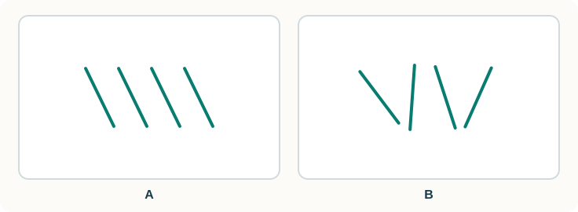

# G10 平行律（Parallelism）

研究层次为 **形状与轮廓**。

## 定义

多条线段或轮廓方向一致、彼此平行时，容易被联读为带状结构或共同边界。

## 图解

左图的线段等长且平行。右图保留线段中心和长度，分别调整角度，削弱共同方向。

## 信息图形中的应用

流程图可用平行泳道表达不同角色使用同一套阶段。是否同时发生，要靠时间标记或说明交代。

平行律比较多条线之间的方向。良好连续律强调同一条路径能否顺着走向延伸。

## 相关案例与对照

[《PlayStation 演变图》](../02-案例与设计分析/01-PlayStation演变图.md)

## 来源

- [Wagemans 等（2012），视觉知觉中的分组与图底组织](https://doi.org/10.1037/a0029333)

[返回目录](../README.md) · [概念与分类框架](../00-Gestalt概念与分类框架.md)
