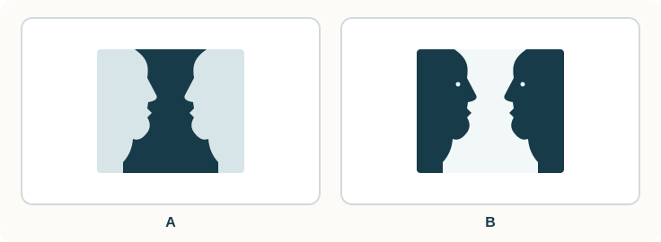

# G11 图底关系（Figure–Ground Organization）

研究层次为 **整体知觉组织**。

## 定义

画面中的某些区域会被看作具有边界的前景对象，周围的区域被理解为背景。在有歧义的图中，两者可能交替。

## 图解

两幅图沿用同一条分界。左图较容易看出深色的中间形状，右图加上眼睛作为提示，提醒读者把两侧也看作两张相对的侧脸。

## 信息图形中的应用

地图上用较浅的底图承载定位信息，用较深且清楚的线和符号表达主路与站点。需要突出重点时，可在已清晰分开的图层内再加直接标签。

辅助背景仍要有足够的辨识度。图底负责区分主体与背景，局部突出还取决于色彩、大小和位置。

## 相关案例与对照

[《财富》都会区营收图](../02-案例与设计分析/02-财富500强都会区营收图.md) · [香港天文台月度降雨图](../02-案例与设计分析/03-香港天文台月度降雨图.md)

## 来源

- [Wagemans 等（2012），视觉知觉中的分组与图底组织](https://doi.org/10.1037/a0029333)

[返回目录](../README.md) · [概念与分类框架](../00-Gestalt概念与分类框架.md)
