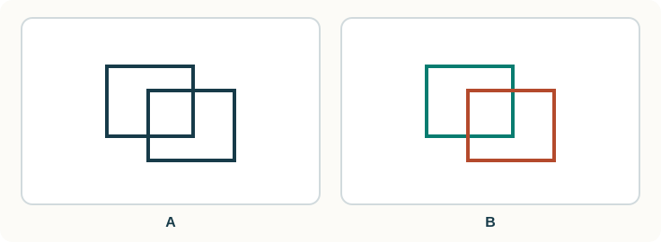

# G12 良好形态原则（Prägnanz）

研究层次为 **整体知觉组织**。

## 定义

在给定刺激和观看条件下，人倾向把视觉线索组织成较稳定、规则、容易辨认的整体。

## 图解

重叠的线段在左图形成多处交叉。右图用不同的色彩标明同样的轮廓，帮助读者辨认它可以被组织为两个规则的矩形。

## 信息图形中的应用

复杂信息图可先确定整体阅读骨架，比如日期统一成列，指标按行对齐，再安排个别注释。

良好形态也包含可辨认和有秩序。必要的单位、来源和注释应该在整体结构中有明确的位置。

## 来源

- [Wagemans 等（2012），视觉知觉中的分组与图底组织](https://doi.org/10.1037/a0029333)
- [Van Geert 与 Wagemans（2024），视觉知觉中的良好形态原则](https://doi.org/10.3758/s13423-023-02344-9)

[返回目录](../README.md) · [概念与分类框架](../00-Gestalt概念与分类框架.md)
