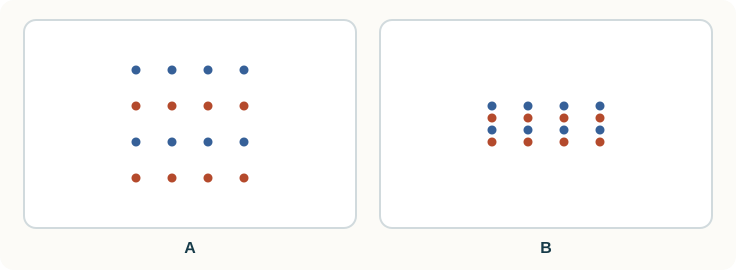

# 01 A/B 对照：间距与颜色

同一行的圆颜色相同。如果相邻行之间变得很近，第一眼会按行看、按列看，还是读不出清楚的组？

| 条件 | A | B |
|---|---:|---:|
| 横向中心距（SVG 坐标单位） | 36 | 36 |
| 纵向中心距（SVG 坐标单位） | 36 | 12 |
| 点数与半径 | 16 个，半径 4.5 | 16 个，半径 4.5 |
| 颜色 | 隔行交替着色 | 同 A |

**唯一调节项**　纵向中心距。两组点阵都围绕各自画框的中心排列。A 版颜色提供按行线索，B 版保留这一线索，同时让列内相邻的圆更近。

**观察问题**　「第一眼看到的是按行分组、按列分组，还是没有明显分组？」可用同样的显示尺寸分别呈现两版，记录每版的选择人数。若同一人看两版，应交替安排呈现先后。

**待核对判断**　B 的按列选择比例可能比 A 高。

| 版本 | 有效观察人数 | 按行 | 按列 | 其他或不明确 |
|---|---|---|---|---|
| A | 待记录 | 待记录 | 待记录 | 待记录 |
| B | 待记录 | 待记录 | 待记录 | 待记录 |

关联 [接近律](../01-规则库/G01-接近律.md)、[相似律](../01-规则库/G02-相似律.md)。

[返回 05 目录](../README.md)
