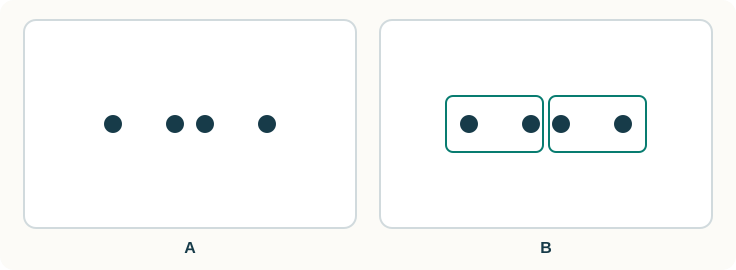

# 02 A/B 对照：边框与间距

四个点排成一行，中间两个点最接近。现在用两个框分别围住左边两点和右边两点，第一眼会怎样配对？

| 条件 | A | B |
|---|---|---|
| 左至右相邻中心距（SVG 坐标单位） | 62、30、62 | 62、30、62 |
| 点数、颜色与半径 | 4 个深色圆，半径 9 | 同 A |
| 可见分组边框 | 无 | 左两点一框，右两点一框 |

**唯一调节项**　成组边框的有无。距离线索指向中间的第 2、3 个点，加入边框后，区域线索指向 1–2 与 3–4 两个组。

**观察问题**　「哪些点看起来在同一组？」从左到右按 1 至 4 号记下回答。用相同显示尺寸比较两版，记录左右分组、中间成对及其他选择的人数。

**待核对判断**　B 的左右分组选择比例可能比 A 高。

| 版本 | 有效观察人数 | 中间成对 | 左右两组 | 其他或不明确 |
|---|---|---|---|---|
| A | 待记录 | 待记录 | 待记录 | 待记录 |
| B | 待记录 | 待记录 | 待记录 | 待记录 |

关联 [共同区域律](../01-规则库/G05-共同区域律.md)、[接近律](../01-规则库/G01-接近律.md)。

[返回 05 目录](../README.md)
