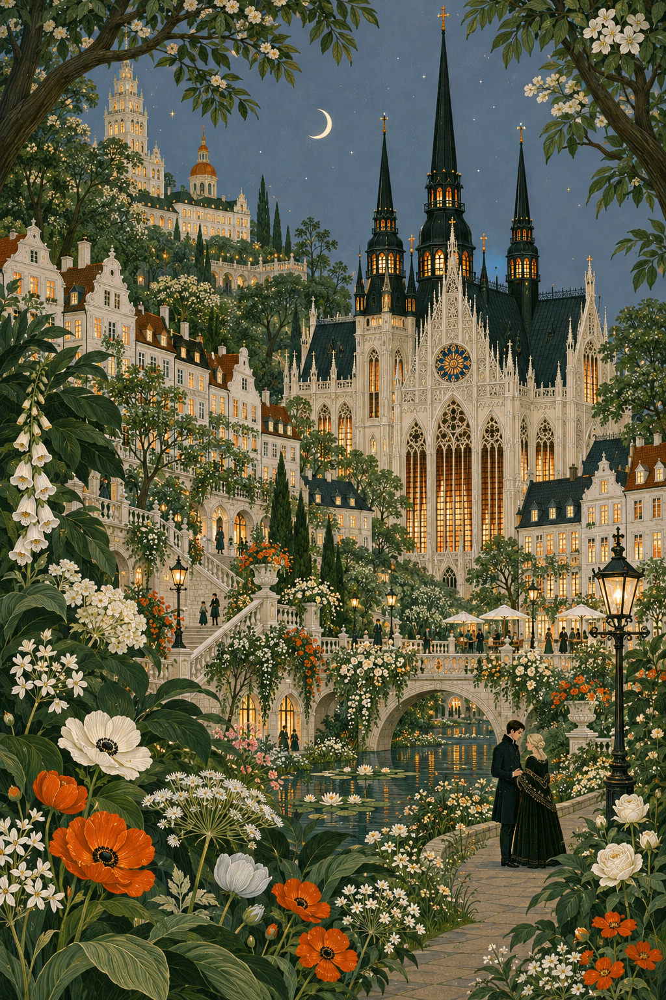

# STYLE-CASE-001：夜城花园的风格分析与克隆

状态：单张参考的作品级提取，profile=provisional，版本 0.1.0。实际作者、创作工具和原始媒介未确认。仓库根目录 SYSTEM.md 读取返回 404，本次依据现有 SC-IMG 1.0.0 核心与操作规范执行。

## 01 启动

读取 CORE、OPERATIONS 与 bundle 数据约定；查看用户提供的参考图。任务为提取、同主题克隆和案例归档。纯叙事插画无统计数据，不强行接入图符计数或统计复算。

## 02 确定任务

先保持花园、夜间幻想城镇和微小人物的题材，测试同主题复现；同时输出主题可替换的通用模板。两者分开保存，不能用同主题成功证明跨主题通用。

## 03 证据登记

REF001 为用户提供的夜城花园参考，已查看。记录九个证据区域：建筑与花叶、整体配色、窗灯、轮廓、材质细节、疏密分布、边缘框景、相对尺度及几何/有机形态。事实观察与生成要求分开写入 evidence 与 rules。

## 04 十三维分析

| 维度 | 可见证据与结论 |
|---|---|
| 风格身份 | 细密装饰性叙事绘画，具有复古童话氛围；不能由此确定真实画种或作者。 |
| 色彩 | 深绿与橄榄绿植被、灰蓝天空、象牙色建筑构成主色关系；暖窗与橙红花朵为小面积强调。没有进行精确取色测量。 |
| 光照 | 暖窗、灯笼与零星亮点嵌入冷暗环境，光晕有限，暗部仍有层次。 |
| 构图 | 上方树枝与下方花木框景，城镇在遮挡中层层深入；建筑竖向走势增强向上延伸。 |
| 尺度 | 前景花叶相对巨大，人物远小于建筑，环境主导；这是远景条件规则。 |
| 造型 | 尖塔、窗格、雕饰的重复秩序与花叶有机曲线并置。 |
| 绘画语言 | 平整哑光色面、细线和受控明暗；没有主导画面的粗厚笔触。 |
| 边缘 | 叶缘、塔尖和窗格细而明确，内部明暗较柔和；不是整图柔焦。 |
| 完成度 | 建筑花纹、花瓣叶脉精修，天空与远处行人概括。 |
| 纹理 | 对象内部细节表达材质；不能仅凭可见纹理断言纸张或颜料。 |
| 密度 | 植被和建筑都很密，上方天空提供相对安静区域；不是统一的主体密、背景疏。 |
| 锚点 | 浅色主建筑与暖窗、橙花和小人物组成多级注意点。 |
| 张力 | 巨大环境与微小人物、冷暗背景与暖亮窗口、规整建筑与有机植物相互对照。 |

## 05 提取规则

R001 精细装饰性绘画；R002 冷暗基底与浅色形体、暖色强调；R003 局部暖光；R004 清晰细轮廓与柔和内部明暗；R005 对象特定纹理；R006 有序繁密与安静区域；R007 远景框景叠层；R008 远景环境主导与小人物；R009 规整重复与有机轮廓。

R007/R008 仅在 shot_type=wide 时启用，其余为本案例暂定核心。confirmed 表示本轮采纳为生成约束，未表示视觉验证成功。九条规则均有证据，推向新题材的可靠性尚需测试。

## 06 分离内容与风格

城堡、哥特尖塔、情侣、月牙、花卉品种和具体位置属于当前内容。可复用的是明暗、冷暖、细节、边缘和空间组织关系。换题材不应自动继续生成城堡或情侣。

## 07 适配克隆任务

本轮为竖幅 2:3 的夜间欧洲幻想城镇花园，保留暖窗、尖塔、小尺度成年情侣与月牙，重新组织建筑和植物细节。无新增标题水印。没有宣称逐像素复制或人物身份复现。

## 08 校验

bundle 结构检查无错误；四版由同一档案编译，规则 ID 与条件一致。中英文为对应描述，但没有独立第三方语义评审。

## 09 四版交付

本目录根部四个 prompt 文件为通用模板；clone_prompts 为本次具体主题提示词。bundle_template.json 用于换主题，bundle_clone.json 记录本次任务。coverage.json 提供覆盖与源摘要。

## 10 实际生成

通过内置图片生成工具，参考图同时承担风格与本轮同主题内容参考角色。实际生成额外采用参考图视觉条件，因此不能将结果当作纯文本提示词单独有效的证明。生成结果与检查状态见生成记录.json。

## 11 审计标准

重点查：是否变成光滑三维；深绿是否变为青蓝霓虹；窗灯是否泛光过强；远近是否因景深丢失细节；建筑纹饰与植物细节是否变粗；人物是否变大；是否保留相对安静天空。没有实际检查的规则不得记 pass，不报告无依据的相似度百分比。

## 12 归档与复用

用户在本轮明确要求加入仓库。以独立 STYLE-CASE 编号归档，避免与信息图 CASE 编号混淆。下次修改 task 并重新判断条件；近景、白天、纯产品和抽象主题尚未验证。核心更改需派生新版本。

## 第一版实际结果

已生成并查看。冷暖配色、环境主导、框景与细密建筑保留；前景叶脉和花瓣出现更硬的刻线感，R005 判 fail。新增水面拱桥属于内容变化。总体作为第一版试作归档，尚未通过全部 must，不升级 validated。下一轮应减弱叶脉与花瓣线条对比，保留结构细节并回查其余规则。
