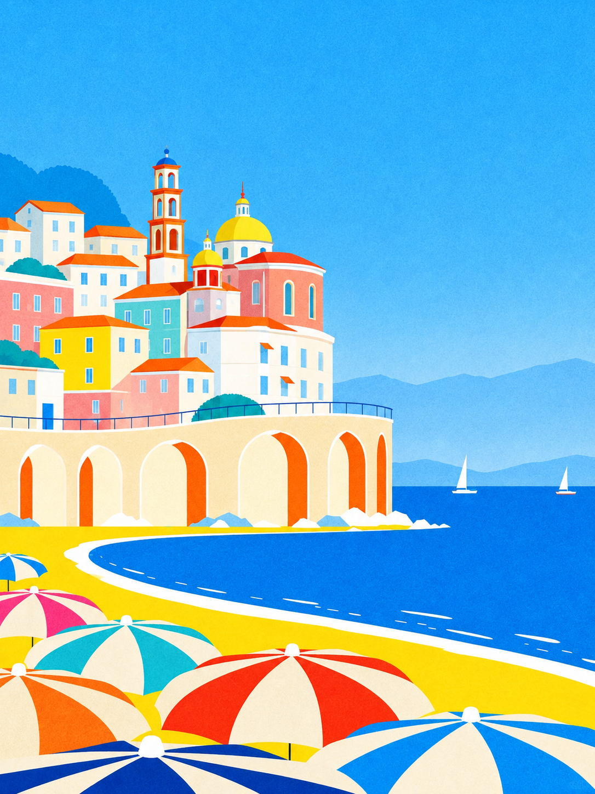

# STYLE-CASE-003：晴海彩伞

高饱和复古旅行海报式插画，档案版本 0.1.0，状态 provisional。用户已看过预览并授权归档。

- [十二步分析与十三维观察](./逐步分析.md)
- [完整通用档案](./bundle_template.json) · [本次克隆任务](./bundle_clone.json)
- [中文 JSON](./01_prompt_zh.json) · [英文 JSON](./02_prompt_en.json)
- [中文简易提示词](./03_prompt_zh_simple.txt) · [英文自然语言提示词](./04_prompt_en_natural.txt)
- [本次实例四版](./clone_prompts/) · [实际生成提示词](./generation_prompt.txt)
- [逐规则审计](./review.json) · [生成记录](./生成记录.json)

首轮定性审阅中十条风格规则均有对应表现，蓝黄配色、几何简化、平面色块与疏密关系得到保留。仍有差异：建筑排列更规整、部分拱洞较尖、颗粒组织略偏细碎斑驳。该结论仅限本次附参考图的同主题试作，不是相似度测量、独立盲评或跨主题验证。档案保持 provisional。

原始参考图未随本次公开提交，来源为用户聊天附件；作者和真实地点未确认。

[返回风格系统](../../README.md)
