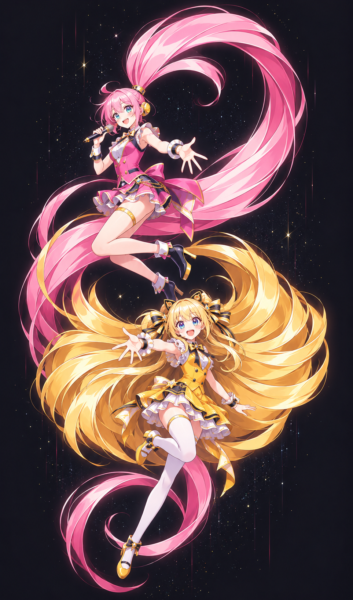

# STYLE-CASE-004：星屑双奏

用户已查看首轮预览并授权归档。档案版本 0.1.0，状态 provisional，审计仍有未通过项。

- [十二步分析与十三维观察](./逐步分析.md)
- [完整通用档案](./bundle_template.json) · [本次克隆任务](./bundle_clone.json)
- [中文 JSON](./01_prompt_zh.json) · [英文 JSON](./02_prompt_en.json)
- [中文简易提示词](./03_prompt_zh_simple.txt) · [英文自然语言提示词](./04_prompt_en_natural.txt)
- [本次实例四版](./clone_prompts/) · [实际生成提示词](./generation_prompt.txt)
- [逐规则审计](./review.json) · [生成记录](./生成记录.json)

首轮偏差：金发高光偏锐利、金属感偏强，服饰与发束细节较繁复。R004 未通过，归档不代表已修正或完美克隆。实际生成使用参考图，尚未验证纯文字独立生成、其他主题或其他模型。原参考图未公开提交，原作者未确认。

[返回风格系统](../../README.md)
