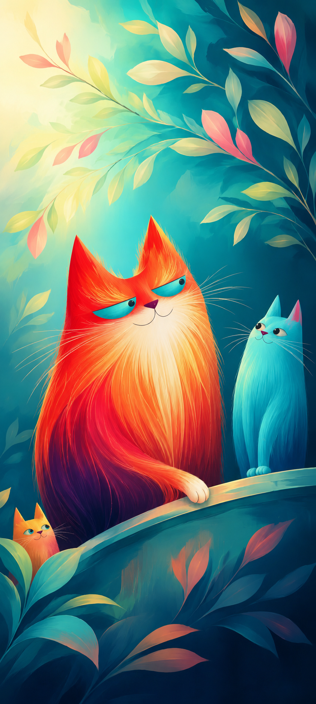

# STYLE-CASE-006：青绿花园猫

用户已查看变奏图并授权生成四版提示词、入库。档案 0.1.0，状态 provisional。

## 四版通用提示词

- [中文 JSON](./01_prompt_zh.json)
- [英文 JSON](./02_prompt_en.json)
- [中文简易提示词](./03_prompt_zh_simple.txt)
- [英文自然语言提示词](./04_prompt_en_natural.txt)

选一版配合参考图使用，不需要同时粘贴四版。更换主题请使用 [完整风格档案](./bundle_template.json)，填写任务后重新适配；本档案的猫脸和毛发规则不能直接用于所有动物或无毛主题。

## 本次作品

- [本次三猫变奏档案](./bundle_clone.json) · [实例四版提示词](./clone_prompts/)
- [实际生成提示词](./generation_prompt.txt) · [审计](./review.json) · [生成记录](./生成记录.json)

## 提取与复用说明

1. 参考为用户提供的青绿背景、橙红主猫插画，已查看，作者与媒介未确认。
2. 主色关系是暖橙红对冷青绿，亮奶白对下部深紫蓝；不是将所有对象机械染成同一颜色。
3. 造型以高长几何轮廓、尖耳与半闭眼形成诙谐气质；此部分仅适合猫主题。
4. 细长方向性毛线与宽松植物笔触形成核心对照，脸部清楚、背景适度柔化。
5. 保留一个大主形和少量小配角的层级，上方留出植物空间。
6. 变奏将四猫改为三猫，加入歪头搭爪，重组台沿、枝叶与亮区位置，避免照搬。
7. 通用与实例四版从相同档案规则编译，结构检查通过；不能据此证明视觉或双语语义完全等价。
8. 实际生成使用参考图。首轮定性审阅保留主要关系，但叶片更整齐、边缘略锐；不报告虚构相似度。
9. 后续换主题须重新适配条件和内容；未验证纯文本独立生成、跨主题或其他模型。原始参考图未随本次公开提交。

[返回风格系统](../../README.md)
