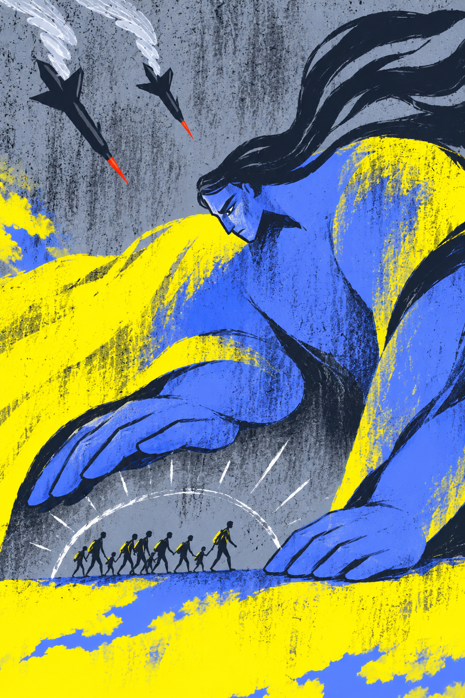

# STYLE-CASE-007：蓝黄守护

用户已查看变奏图和四版提示词，并明确授权归档。本案例为同主题变奏，状态 provisional。

## 四版提示词

- [中文 JSON](./01_prompt_zh.json)
- [英文 JSON](./02_prompt_en.json)
- [中文简易提示词](./03_prompt_zh_simple.txt)
- [英文自然语言提示词](./04_prompt_en_natural.txt)

以上为用户审阅的同一任务四种表达，任选一版配合参考图使用。JSON 是提示词描述格式，不是 SC-IMG 完整 bundle，也不是平台 API 请求。文件包含本次守护者、人群与威胁符号，不能直接当作任意主题的通用档案。

## 风格与内容的分离

画法核心：高饱和蓝黄、冷灰底、近黑结构、少量朱红强调；大色块、粗粝干刷、纵向擦痕与不规则边缘；夸张体量对照、简化人群剪影、白色刮线。

本次内容：巨大的守护者俯身保护地面人群，两条手臂建立庇护空间，上方两枚象征性导弹。新构图没有复制原图的双手托人、王冠、三个威胁符号及文字。

换主题时应重写 theme、new_composition 和内容相关限制，再检查画法是否适用；不能机械保留导弹或守护者。

## 实际生成与差异

[实际生成提示词](./generation_prompt.txt) · [生成记录](./生成记录.json)

先生成样图，后将可复用要求整理成经用户审阅的四版；四版不冒充生成当时逐字输入。实际生成附带图片参考，未验证纯文本独立效果。新图保留色彩和粗粝感，但纹理覆盖更密，头部与手部更具体，原图更概括。没有量化相似度或跨主题通过记录。

原始参考图未随本次公开提交，原作者与完整来源未确认。

[返回风格系统](../../README.md)
